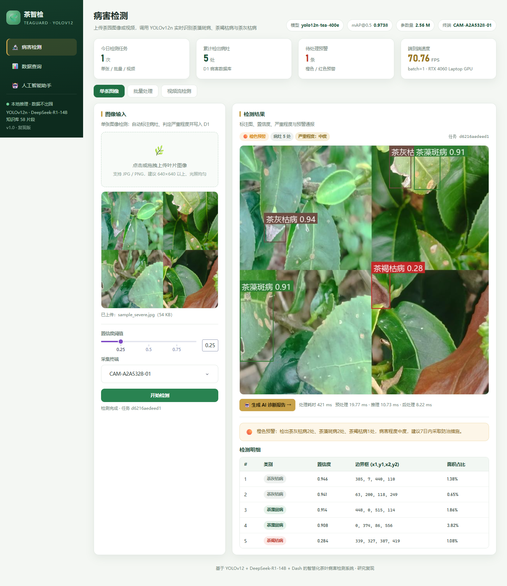

# 基于 YOLOv12 的智慧化茶叶病害检测系统 —— 复现工程

本目录是对论文《基于YOLOv12的智慧化茶叶病害检测系统的研究与应用》的完整软件复现：数据集核验与划分、YOLOv12n 训练、指标评估与速度基准、Dash 三页交互系统、D1 病害数据库、D2 茶叶向量知识库、本地 DeepSeek-R1-14B 检索增强问答，以及端到端测试与截图。

> 快速验收：见 [`docs/README_FIRST.md`](docs/README_FIRST.md)。
>
> **复现范围**：除硬件落地（Basler ace2 a2A5328-4gmIP67 工业相机、GigE 采集、IP65/67 防护、均匀光源）外，论文中描述的全部软件与实验工作均已实现。系统以终端编号 `CAM-A2A5328-01` 模拟采集终端，图像与视频通过上传或数据集输入。

---

## 1. 结果速览

| 指标 | 论文值 | 本复现值 | 说明 |
| --- | --- | --- | --- |
| mAP@0.5（测试集） | 0.955 | **0.9738** | 400 epochs / batch 16 / 640 |
| mAP@0.5:0.95（测试集） | 0.8457 | **0.9141** | conf=0.001；conf=0.25 时为 0.8913 |
| 参数量 | 2,557,313 | **2,557,313** | YOLOv12n，完全一致 |
| GFLOPs | 6.3 | **6.32** | 640×640 |
| 模型文件 | 5.3 MB | **5.36 MB** | `best.pt`（已剥离优化器） |
| 端到端 FPS（batch=1） | 189.30 | **70.76** | 单流受 kernel 启动/功耗限制 |
| 批处理吞吐（batch=4） | — | **349.77 img/s** | 补充测量，见 `reports/benchmark.json` |
| 数据集 | 2723 张（2178/272/273） | 2723 张（2178/272/273） | 8:1:1，无跨集重复 |
| 大语言模型 | DeepSeek-R1-14B 本地部署 | DeepSeek-R1-Distill-Qwen-14B Q4_K_M（llama.cpp） | 完全离线 |

训练曲线、PR/F1/混淆矩阵、数据集分布、系统截图均保存在 `reports/figures/` 与 `docs/screenshots/`。



更多截图见 [`docs/screenshots/README.md`](docs/screenshots/README.md)。

## 2. 目录结构

```
Tea-leaf-detection/
├─ src/
│  ├─ app.py                  # Dash 入口（三页路由、/media、/health）
│  ├─ train.py                # YOLOv12n 训练（支持 resume）
│  ├─ evaluate.py             # test/val 指标评估
│  ├─ benchmark.py            # 参数量/GFLOPs/文件大小/推理速度
│  ├─ dataset_report.py       # 数据划分、类别均衡、标注质量、泄漏检查
│  ├─ split_dataset.py        # 分层 8:1:1 重新划分
│  ├─ plot_training.py        # 训练曲线
│  └─ teasys/
│     ├─ config.py            # 全局配置（模型、阈值、LLM、知识库）
│     ├─ detector.py          # 推理 + 中文标注 + 视频处理 + 严重度判定
│     ├─ db.py                # D1 SQLite 数据库与统计/导出
│     ├─ knowledge.py         # D2 文档分块、BGE 向量、混合检索
│     ├─ llm.py               # llama.cpp / Ollama / OpenAI 客户端
│     ├─ assistant.py         # RAG 提示词、问答、报告生成
│     ├─ components.py        # UI 组件
│     └─ pages/               # 检测 / 查询 / AI 助手三页
├─ knowledge/                 # D2 语料（11 篇 Markdown）
├─ data/
│  ├─ tea.yaml                # 数据集配置（需按本机路径修改）
│  ├─ samples/                # 演示图像与视频
│  └─ tea_system.db(运行时生成) # D1 数据库
├─ models/                    # best.pt（已包含）+ BGE/GGUF（需下载）
├─ runs/detect/yolo12n_tea_400/  # 训练日志 results.csv 与曲线（权重见 models/）
├─ reports/                   # metrics/benchmark/dataset JSON 与图表
├─ docs/                      # 复现报告、系统设计、验收清单、截图
├─ scripts/                   # 端到端测试、LLM 测试、构建脚本
└─ requirements.txt
```

## 3. 环境

- Python 3.12，PyTorch 2.5.1 + CUDA 12.1
- Ultralytics 8.4.57（内置 YOLOv12）
- Dash 4.5.0 + 自定义 CSS
- llama-cpp-python 0.3.36（CPU 推理）
- transformers 4.49.0 + BAAI/bge-small-zh-v1.5

安装：

```bash
pip install -r requirements.txt -i https://pypi.tuna.tsinghua.edu.cn/simple
```

模型与数据：

- `models/best.pt`：**已包含**，复现训练的 YOLOv12n 权重（5.36 MB）。
- `models/bge-small-zh-v1.5/`：需下载，约 96 MB，见 [`models/README.md`](models/README.md)。
- `models/DeepSeek-R1-Distill-Qwen-14B-Q4_K_M.gguf`：需下载，8.37 GB；GitHub 无法托管，下载方式见 [`models/README.md`](models/README.md)。
- 数据集：本仓库不含图像，请按 [`data/README.md`](data/README.md) 准备，并修改 `data/tea.yaml` 的 `path`。

## 4. 快速开始

```bash
cd Tea-leaf-detection   # 仓库根目录
python src/app.py
# 浏览器打开 http://127.0.0.1:8050
```

其他命令：

```bash
# 训练（400 epochs，batch 16，RAM/磁盘缓存可选）
python src/train.py --epochs 400 --batch 16 --cache ram

# 断点续训
python src/train.py --resume --name yolo12n_tea_400

# 评估测试集（生成 JSON/CSV/PR/F1/混淆矩阵）
python src/evaluate.py --weights models/best.pt --split test

# 速度与复杂度基准
python src/benchmark.py --weights models/best.pt

# 数据集审计
python src/dataset_report.py

# 训练曲线
python src/plot_training.py
```

## 5. 系统功能

### 5.1 检测功能页 `/detection`
- **单张图像**：上传叶片图，实时标注病斑、显示类别/置信度/边界框/面积占比，判定严重程度并生成预警。
- **批量处理**：多图上传、逐文件推理、类别分布图、标注结果 ZIP 下载。
- **视频流检测**：上传视频（默认前 60 秒），逐帧推理、H.264 标注视频、逐秒检出曲线、峰值病灶与类别统计。

所有检测结果写入 D1，并生成预警记录。

### 5.2 数据查询页 `/records`
- 按日期、类别、终端、任务类型、最低置信度、关键词组合检索。
- KPI、近 14 天趋势、类别分布、置信度直方图、终端分布。
- 分页浏览、点击任务 ID 跳转 AI 助手。
- Excel 导出（任务汇总 + 检测明细两个工作表）。

### 5.3 AI 助手页 `/assistant`
- 自动载入检测任务上下文（类别、置信度、严重度、标注图）。
- D2 知识库混合检索（BGE 向量 + BM25 + RRF），显示引用片段与来源。
- 本地 DeepSeek-R1-14B 生成诊断与防治建议，支持多轮对话、历史会话回看。
- 上传 TXT/CSV/JSON/MD 检测报告进行“文件理解”。
- 一键生成结构化诊断报告（Markdown 导出）。
- “最近一周趋势”按钮：汇总 D1 数据后交给大模型分析。

## 6. 本地大模型与数据安全

- 默认后端：`llamacpp`，模型 `DeepSeek-R1-Distill-Qwen-14B-Q4_K_M`，CPU 20 线程，n_ctx 8192。
- 完全离线：模型、知识库、数据库、图像均在本地，推理过程无外部网络请求。
- CPU 推理速度约 4～6 token/s，一次回答约 1～4 分钟；界面会显示加载提示。
- 可通过环境变量切换后端：

```bash
set TEA_LLM_PROVIDER=ollama
set TEA_LLM_MODEL=deepseek-r1:14b
set TEA_LLM_BASE_URL=http://127.0.0.1:11434
```

## 7. 严重程度与预警

| 病灶数与面积占比 | 严重程度 | 预警 |
| --- | --- | --- |
| 无病灶 | 无 | 正常 |
| ≤2 且 <3% | 轻度 | 黄色提示 |
| ≤5 且 <12% | 中度 | 橙色预警 |
| >5 或 ≥12% | 重度 | 红色预警 |

该规则是系统预警分级，不等同于农学病情指数；田间诊断仍需结合病叶率、病情指数与实验室检测。

## 8. 复现说明与差异

1. **训练轮数**：论文表格写 300 epochs、图注写 400 周期，实际 `results.csv` 为 400；本复现按 400 执行，以对齐最终指标与图注。
2. **batch**：论文表格为 16，作者原始 `args.yaml` 为 8；本复现采用 16。
3. **数据集**：直接使用论文配套的 2723 张划分数据；另用 `split_dataset.py` 以分层抽样重建，得到 2179/272/272，验证划分可复现。
4. **硬件**：Basler 相机与 IP65/67 防护不在复现范围；系统保留上传/视频输入接口。
5. **大模型**：论文写 DeepSeek-R1-14B，本复现使用同尺寸的 DeepSeek-R1-Distill-Qwen-14B Q4_K_M（GGUF）本地部署；CPU 推理延迟高于 GPU。
6. **FPS**：论文在 RTX 4060 Laptop GPU 上测得 189.30 FPS；本复现同一硬件实测值见 `reports/benchmark.json`，测量口径为 Ultralytics `result.speed`（预处理+推理+后处理）。

## 9. 验收

见 `docs/acceptance_checklist.md`，包含启动步骤、逐页检查项、命令与预期输出，以及已知限制。

## 10. 致谢

论文作者：许文浩、尹航、林宇涵（辽宁科技大学计算机与软件工程学院）。本工程仅用于研究与教学复现。
