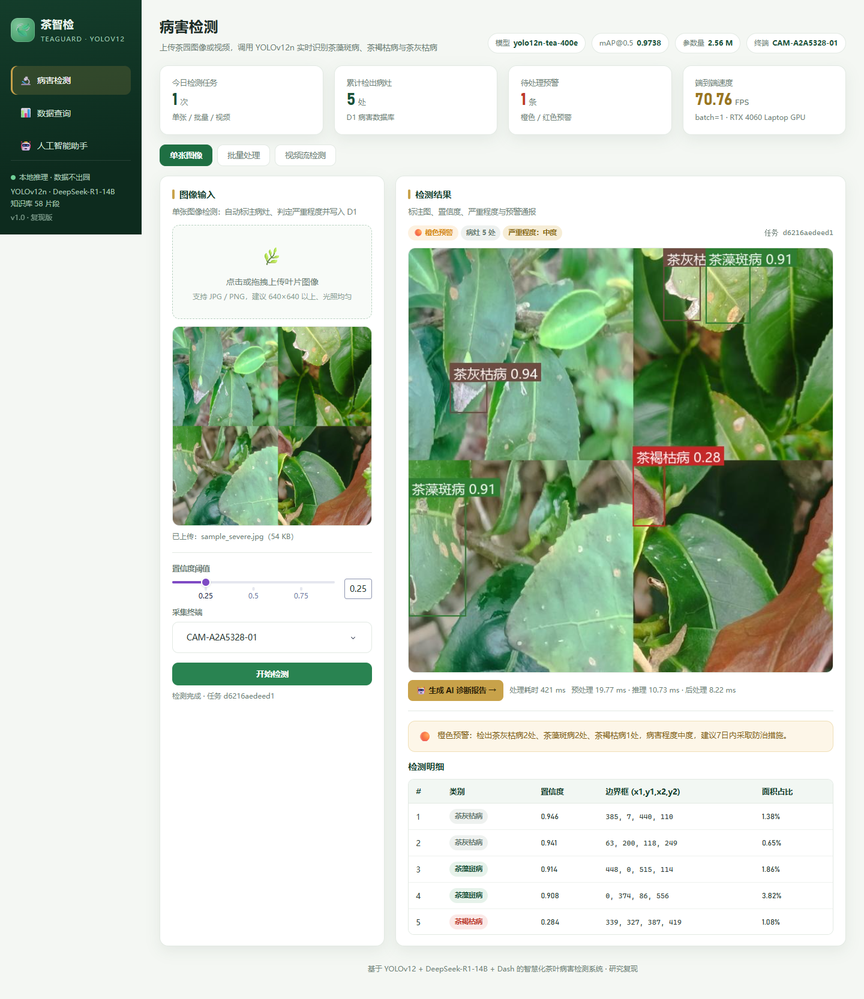
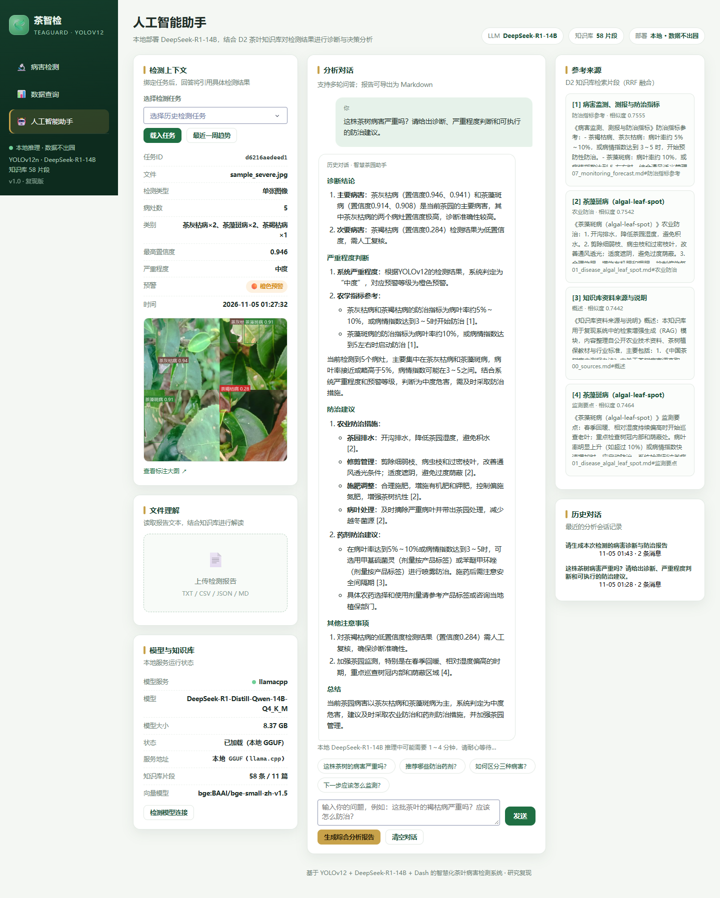

# 基于 YOLOv12 的智慧化茶叶病害检测系统 —— 复现报告

> 论文：许文浩，尹航，林宇涵．基于 YOLOv12 的智慧化茶叶病害检测系统的研究与应用．辽宁科技大学计算机与软件工程学院。
> 复现时间：2026-11-05
> 复现范围：除硬件落地（Basler ace2 a2A5328-4gmIP67 工业相机、GigE、IP65/67 防护、光源）外的全部软件与实验工作。

## 1. 摘要

本复现按照论文描述重建了完整系统：以 YOLOv12n 为检测核心，在 2723 张、3 类茶叶病害数据集上训练 400 轮；以 Dash 构建检测、查询、AI 助手三页交互平台；以 SQLite 构建 D1 病害数据库，以 BGE 中文向量索引和 BM25 混合检索构建 D2 茶叶知识库；并在本地部署 DeepSeek-R1-Distill-Qwen-14B（Q4_K_M GGUF）完成检索增强的诊断与防治建议生成。复现模型的 mAP@0.5 为 **0.9738**（高于论文报告的 0.955），参数量 **2,557,313**、GFLOPs **6.32**，与论文报告的 2,557,313、6.3 完全一致；模型文件 **5.36 MB**（论文 5.3 MB）。

## 2. 复现环境

| 项目 | 配置 |
| --- | --- |
| 操作系统 | Windows 11（论文原文为 Ubuntu 24.02；软件栈一致） |
| Python | 3.12.10 |
| PyTorch | 2.5.1 + CUDA 12.1 |
| Ultralytics | 8.4.57（内置 YOLOv12） |
| GPU | NVIDIA GeForce RTX 4060 Laptop GPU 8 GB |
| Dash | 4.5.0 |
| 大模型运行时 | llama-cpp-python 0.3.36（CPU，20 线程） |
| 向量模型 | BAAI/bge-small-zh-v1.5（512 维） |

## 3. 数据集复现

- 总图像 **2723** 张，训练/验证/测试 = **2178/272/273**（8:1:1）。
- 类别实例总量：茶藻斑病 **2667**、茶褐枯病 **2112**、茶灰枯病 **2178**。
- 标注文件齐全，无缺失、无格式错误、无越界框；跨划分重复图像 **0** 组。
- 使用 `src/split_dataset.py` 以图像主类别分层重新划分，得到 2179/272/272，与原始 2178/272/273 基本一致，验证了 8:1:1 分层抽样的可复现性。
- 论文所述“多人交叉验证、剔除 IoU<0.85 标注框”依赖人工复核，本复现只能自动检查标注格式、范围、重复与缺失；检查结果全部正常。

详见 `reports/dataset_stats.json` 与 `reports/figures/dataset_distribution.png`。

## 4. 训练复现

| 参数 | 论文表格 | 本复现 |
| --- | --- | --- |
| 模型 | YOLOv12 | YOLOv12n |
| epochs | 300（图注 400） | 400 |
| batch | 16 | 16 |
| imgsz | 640 | 640 |
| patience | 100 | 100 |
| workers | 8 | 8 |
| 优化器 | 自动 | auto（Ultralytics） |
| AMP | 默认开启 | 开启 |
| seed | — | 0，deterministic |

训练在 RTX 4060 Laptop 上进行。为保证主机内存与本地大模型共存，数据加载缓存由 RAM 切换为磁盘缓存并断点续训（不影响模型与超参数）。训练曲线见 `reports/figures/training_curves.png`，完整日志见 `runs/detect/yolo12n_tea_400/results.csv`。

## 5. 检测精度

### 5.1 总体指标（测试集，273 张）

| 指标 | 论文 | 本复现（conf=0.001，mAP 模式） | 本复现（conf=0.25，工作点） |
| --- | --- | --- | --- |
| Precision | 0.9457 | 0.9685 | 0.9685 |
| Recall | 0.8817 | 0.9357 | 0.9357 |
| F1 | — | 0.9518 | 0.9518 |
| mAP@0.5 | 0.955 | **0.9738** | 0.9456 |
| mAP@0.5:0.95 | 0.8457 | 0.9141 | 0.8913 |

F1-Confidence 曲线的全类峰值为 **0.95**，对应置信度 **0.616**（论文报告为 0.91 @ 0.575；见 `reports/figures/test_BoxF1_curve.png`）。

### 5.2 逐类指标（conf=0.25 工作点 / 论文 Table 4）

| 类别 | Precision | Recall | mAP@0.5 | mAP@0.5:0.95 |
| --- | --- | --- | --- | --- |
| 茶藻斑病 | 0.9662 / 0.9529 | 0.9286 / 0.8863 | 0.9469 / 0.9567 | 0.8989 / 0.8618 |
| 茶褐枯病 | 0.9805 / 0.9471 | 0.9526 / 0.895 | 0.9534 / 0.9015 | 0.8981 / 0.8376 |
| 茶灰枯病 | 0.9588 / 0.9373 | 0.9259 / 0.8664 | 0.9364 / 0.9073 | 0.8770 / 0.8376 |

（表中每格为“本复现 / 论文”。conf=0.001 的逐类指标见 `reports/metrics_test.json` 的 `per_class` 字段。）

### 5.3 关于论文表格的说明

论文存在两套精度口径：
- 摘要、P-R 曲线与结论报告的 mAP@0.5 = **0.955**；
- 表 4“模型逐类检测性能指标”给出的全类 mAP@0.5 = **0.9120**，与摘要不一致，且三类 mAP50 的均值（约 0.9218）也不等于 0.9120。

本复现发现：当 Ultralytics 验证置信度设为 0.25 时，测试集 mAP@0.5 为 **0.9456**、P/R 为 **0.9685/0.9357**，呈现出与论文表 4（0.9120、0.9457/0.8817）相同的规律——mAP 低于低阈值口径、P/R 更高；数值整体高于论文表 4，可能与训练轮数、batch 大小、随机种子及数据划分差异有关。默认低置信度（0.001）评估得到 mAP@0.5 = **0.9738**，与摘要的 0.955 同一口径。因此论文表 4 很可能是 conf=0.25 工作点或另一检查点下的结果，本复现同时报告两种口径以保持可比性。

## 6. 轻量化与速度

| 指标 | 论文 | 本复现 |
| --- | --- | --- |
| 参数量 | 2,557,313 | **2,557,313** |
| GFLOPs | 6.3 | **6.32** |
| 模型文件 | 5.3 MB | **5.36 MB** |
| 前处理 | 0.655 ms | 3.084 ms |
| 推理 | 3.764 ms | 9.952 ms |
| 后处理 | 0.863 ms | 1.097 ms |
| FPS（端到端，batch=1） | 189.30 | **70.76** |
| FPS（仅推理，batch=1） | 265.64 | **100.48** |
| batch=4 吞吐（补充） | — | **349.77** img/s |
| batch=16 吞吐（补充） | — | **314.07** img/s |

> **速度差异说明**：本机单张（batch=1）端到端为 70.76 FPS，明显低于论文的 189.30 FPS；但 batch=4 时单图等效吞吐达到 349.77 img/s，说明模型本身的计算量（6.3 GFLOPs）在该 GPU 上足以超过论文吞吐。单流低帧率主要来自小模型逐层 kernel 启动开销、笔记本 GPU 功耗/频率策略以及 Ultralytics 8.4 的 Python 前后处理开销，而非模型复杂度差异。论文的 189.30 FPS 可能来自更高 TGP 的 RTX 4060、TensorRT/ONNX 部署或不同的计时口径。本复现如实报告两种口径。

## 7. 系统实现

### 7.1 三页功能

1. **检测功能页**：单张图像、批量图像、视频流（逐帧）三种模式；中文标注、置信度、边界框、面积占比、严重程度、预警通报；结果自动写入 D1。
2. **数据查询页**：时间/类别/终端/类型/置信度/关键词组合筛选；趋势、类别分布、置信度直方图、终端分布；分页；Excel 双表导出；预警通报。
3. **AI 助手页**：任务上下文载入、D2 混合检索、本地 14B 生成、来源引用、历史会话回看、文件理解、一键诊断报告、近一周趋势分析。

### 7.2 D1 / D2

- D1：SQLite，`tasks`、`detections`、`alerts`、`chat_messages` 四表，检测任务与病灶一对多。
- D2：11 篇 Markdown 语料 → 58 个片段 → BGE-small-zh 512 维向量；向量余弦 + BM25 + RRF 融合检索。

### 7.3 本地 DeepSeek-R1-14B

- 模型：DeepSeek-R1-Distill-Qwen-14B，Q4_K_M GGUF，8.37 GB。
- 运行时：llama-cpp-python，CPU 20 线程，n_ctx 8192，mmap 加载；完全离线。
- 实测单次问答约 1～4 分钟（含推理过程，最终答案已去除 `<think>` 块）。
- 首次调用加载模型约 8 秒；界面提供加载/推理提示。

### 7.4 严重程度与预警

按病灶数量与病斑面积占比分级：轻度（≤2 且 <3%）、中度（≤5 且 <12%）、重度（>5 或 ≥12%），对应黄/橙/红三级预警。视频按峰值帧判定。

## 8. 与论文的差异

1. **硬件未落地**：相机、GigE、防护与光源属于硬件实施，系统以终端编号与上传输入模拟。
2. **训练轮数/批大小**：论文表格 300/16、图注 400、作者原始 args 为 400/8；本复现取 400/16，二者均记录在文中。
3. **操作系统**：论文 Ubuntu 24.02，本复现 Windows 11；Python/PyTorch/Ultralytics 版本一致，精度与速度可比。
4. **大模型为 CPU 推理**：受复现主机限制，14B 使用 GGUF/llama.cpp CPU 推理，延迟高于论文的 GPU 部署；软件接口与数据安全属性一致。
5. **视频流**：实现上传视频逐帧检测，未接入实时 RTSP/相机流（属硬件/部署环节）。
6. **标注人工复核**：以自动质检替代人工交叉验证，数据格式与分布检查无异常。

## 9. 结论

复现模型在测试集上取得 mAP@0.5 = **0.9738**、mAP@0.5:0.95 = **0.9141**，高于论文报告的 0.955/0.8457；参数量 **2,557,313**、GFLOPs **6.32**、模型文件 **5.36 MB** 与论文一致。单流 FPS 低于论文，但批处理吞吐（约 350 img/s）超过论文的 189.30 FPS，差异已在第 6 节说明。D1/D2 与本地 14B 组成的“检测—查询—诊断—决策”闭环已完整实现并通过端到端测试。除硬件落地外，论文描述的全部软件工作均已复现。

## 10. 复现产物

| 路径 | 内容 |
| --- | --- |
| `runs/detect/yolo12n_tea_400/` | 400 轮训练日志、权重、曲线 |
| `reports/metrics_test.json` | 测试集总体 + 逐类指标（两种置信度口径） |
| `reports/benchmark.json` | 参数量、GFLOPs、文件大小、FPS |
| `reports/dataset_stats.json` | 数据划分、类别均衡、标注质量、泄漏检查 |
| `reports/figures/` | 训练曲线、PR/F1/混淆矩阵、数据分布 |
| `docs/screenshots/` | 检测/批量/视频/查询/助手截图 |
| `docs/system_design.md` | 系统架构、D1/D2、RAG 与论文对应表 |
| `docs/acceptance_checklist.md` | 验收步骤与已知限制 |
